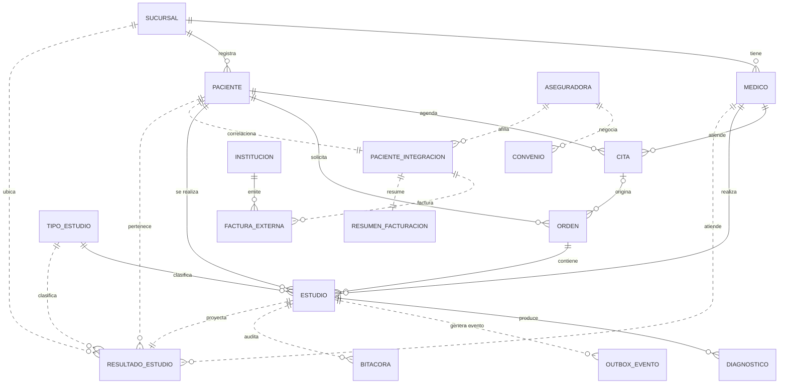

# Modelo de datos

## 1. Vision general

El modelo se divide en tres dominios con identificadores compartidos:

```text
PostgreSQL (OLTP)                 SQL Server (facturacion)        MongoDB (analitica)
-----------------                 -----------------------        -------------------
catalogo.sucursal         1 ----> (no se replica)
catalogo.medico
catalogo.tipo_estudio
catalogo.aseguradora      ----+--> integracion.convenios
                               +--> integracion.paciente_integracion
<region>.pacientes       -----+--> integracion.paciente_integracion
<region>.estudios        ---------> resultados_estudios
<region>.diagnosticos    ---------> resultado.{hallazgo,medida,conclusion}
```

La clave de correlacion entre motores es `id_paciente` y, para analitica,
`id_estudio`. Los identificadores son enteros asignados por rango regional para
evitar colisiones sin necesidad de coordinacion global.

### 1.1 Diagrama entidad-relacion

Las lineas solidas representan llaves foraneas reales dentro de un motor. Las
lineas punteadas representan relaciones logicas entre motores o hacia MongoDB,
donde la integridad se mantiene por identificadores y procedimientos.



## 2. PostgreSQL: catalogo

### `catalogo.sucursal`

| Columna | Tipo | Restriccion |
|---------|------|-------------|
| `id_sucursal` | integer | PK |
| `nombre` | varchar(80) | NOT NULL |
| `region` | varchar(80) | NOT NULL, UNIQUE |
| `direccion` | text | |

### `catalogo.tipo_estudio`

| Columna | Tipo | Restriccion |
|---------|------|-------------|
| `id_tipo` | integer | PK |
| `codigo` | varchar(20) | NOT NULL, UNIQUE |
| `nombre` | varchar(120) | NOT NULL |
| `precio_base` | numeric(12,2) | NOT NULL, >= 0 |
| `modalidad` | varchar(40) | NOT NULL |

### `catalogo.medico`

| Columna | Tipo | Restriccion |
|---------|------|-------------|
| `id_medico` | integer | PK |
| `cedula` | varchar(20) | NOT NULL, UNIQUE |
| `nombre` | varchar(120) | NOT NULL |
| `especialidad` | varchar(80) | NOT NULL |
| `id_sucursal` | integer | FK -> `catalogo.sucursal` |

### `catalogo.aseguradora`

| Columna | Tipo | Restriccion |
|---------|------|-------------|
| `id_aseguradora` | integer | PK |
| `nombre` | varchar(120) | NOT NULL |
| `codigo_externo` | varchar(40) | NOT NULL, UNIQUE |

## 3. PostgreSQL: fragmentos regionales

Cada uno de los esquemas `san_jose`, `alajuela` y `cartago` contiene la misma
estructura.

### `<region>.pacientes`

| Columna | Tipo | Restriccion |
|---------|------|-------------|
| `id_paciente` | integer | PK, IDENTITY con inicio regional |
| `cedula` | varchar(20) | NOT NULL, UNIQUE por region |
| `nombre` | varchar(120) | NOT NULL |
| `apellidos` | varchar(120) | NOT NULL |
| `fecha_nacimiento` | date | NOT NULL |
| `sexo` | varchar(1) | `M`, `F`, `O` |
| `telefono` | varchar(20) | |
| `email` | varchar(120) | |
| `direccion` | text | |
| `id_sucursal` | integer | FK, `CHECK` igual a la region |
| `creado_en` | timestamptz | DEFAULT `now()` |

### `<region>.citas`

| Columna | Tipo | Restriccion |
|---------|------|-------------|
| `id_cita` | integer | PK, IDENTITY |
| `id_paciente` | integer | FK -> pacientes, ON DELETE CASCADE |
| `id_medico` | integer | FK -> `catalogo.medico` |
| `fecha_hora` | timestamptz | NOT NULL |
| `estado` | varchar(20) | PROGRAMADA, ATENDIDA, CANCELADA, REPROGRAMADA |
| `motivo` | text | |
| `creado_en` | timestamptz | DEFAULT `now()` |

### `<region>.ordenes`

| Columna | Tipo | Restriccion |
|---------|------|-------------|
| `id_orden` | integer | PK, IDENTITY |
| `id_cita` | integer | FK -> citas, ON DELETE SET NULL |
| `id_paciente` | integer | FK -> pacientes, ON DELETE CASCADE |
| `fecha` | timestamptz | DEFAULT `now()` |
| `estado` | varchar(20) | ABIERTA, PROCESADA, ANULADA |

### `<region>.estudios`

| Columna | Tipo | Restriccion |
|---------|------|-------------|
| `id_estudio` | integer | PK, IDENTITY |
| `id_orden` | integer | FK -> ordenes, ON DELETE CASCADE |
| `id_paciente` | integer | FK -> pacientes, ON DELETE CASCADE |
| `id_tipo` | integer | FK -> `catalogo.tipo_estudio` |
| `id_medico` | integer | FK -> `catalogo.medico` |
| `fecha` | timestamptz | DEFAULT `now()` |
| `estado` | varchar(20) | PENDIENTE, EN_PROCESO, COMPLETADO, ENTREGADO |
| `resultado` | jsonb | Resultado detallado local |
| `observaciones` | text | |

### `<region>.diagnosticos`

| Columna | Tipo | Restriccion |
|---------|------|-------------|
| `id_diagnostico` | integer | PK, IDENTITY |
| `id_estudio` | integer | FK -> estudios, ON DELETE CASCADE |
| `codigo_cie10` | varchar(10) | NOT NULL |
| `descripcion` | text | NOT NULL |
| `fecha` | timestamptz | DEFAULT `now()` |

Restriccion unica: `(id_estudio, codigo_cie10)`.

## 4. PostgreSQL: auditoria

### `auditoria.outbox_eventos`

| Columna | Tipo | Descripcion |
|---------|------|-------------|
| `id_evento` | bigint | PK, IDENTITY |
| `tipo_evento` | varchar(40) | Por ejemplo `ESTUDIO_CREADO` |
| `id_estudio` | integer | Estudio local asociado |
| `region` | varchar(40) | Region de origen |
| `payload` | jsonb | Datos necesarios para reintentar |
| `estado` | varchar(20) | PENDIENTE, SINCRONIZADO, ERROR |
| `intentos` | integer | Numero de intentos |
| `creado_en` | timestamptz | Fecha de creacion |
| `sincronizado_en` | timestamptz | Fecha de sincronizacion |
| `ultimo_error` | text | Ultimo mensaje de error |

### `auditoria.bitacora_sincronizacion`

| Columna | Tipo | Descripcion |
|---------|------|-------------|
| `id_bitacora` | bigint | PK, IDENTITY |
| `id_estudio` | integer | Estudio afectado |
| `region` | varchar(40) | Region |
| `operacion` | varchar(40) | `SYNC_MONGO` |
| `resultado` | varchar(20) | `OK` o `ERROR` |
| `detalle` | text | Detalle del resultado |
| `ejecutado_en` | timestamptz | Fecha |

## 5. SQL Server: esquema `integracion`

### `integracion.instituciones`

| Columna | Tipo | Restriccion |
|---------|------|-------------|
| `codigo_institucion` | varchar(20) | PK |
| `nombre` | varchar(120) | NOT NULL |
| `tipo` | varchar(30) | ASEGURADORA, HOSPITAL, MINISTERIO |

### `integracion.convenios`

| Columna | Tipo | Restriccion |
|---------|------|-------------|
| `id_convenio` | int | PK, IDENTITY |
| `id_aseguradora` | int | NOT NULL |
| `nombre` | varchar(120) | NOT NULL |
| `porcentaje_cobertura` | decimal(5,2) | 0 a 100 |
| `vigencia_inicio` | date | NOT NULL |
| `vigencia_fin` | date | NULL |

### `integracion.paciente_integracion`

| Columna | Tipo | Restriccion |
|---------|------|-------------|
| `id_paciente` | int | PK |
| `id_aseguradora` | int | NOT NULL |
| `codigo_externo` | varchar(40) | NOT NULL |
| `estado_facturacion` | varchar(20) | PENDIENTE, PAGADA, RECHAZADA, EXONERADA |
| `actualizado_en` | datetime2(0) | DEFAULT `SYSDATETIME()` |

### `integracion.facturas_externas`

| Columna | Tipo | Restriccion |
|---------|------|-------------|
| `id_factura` | int | PK, IDENTITY |
| `numero_factura` | varchar(40) | NOT NULL, UNIQUE |
| `id_paciente` | int | NOT NULL |
| `codigo_institucion` | varchar(20) | FK -> instituciones |
| `monto` | decimal(12,2) | >= 0 |
| `fecha` | date | NOT NULL |
| `estado` | varchar(20) | PENDIENTE, PAGADA, RECHAZADA, EXONERADA |

### `integracion.resumen_facturacion`

| Columna | Tipo | Restriccion |
|---------|------|-------------|
| `id_paciente` | int | PK |
| `total_facturado` | decimal(12,2) | DEFAULT 0 |
| `facturas_pendientes` | int | DEFAULT 0 |
| `ultima_fecha` | date | NULL |
| `calculado_en` | datetime2(0) | DEFAULT `SYSDATETIME()` |

`resumen_facturacion` se recalcula con `usp_RecalcularResumenPaciente` y
`usp_RecalcularResumenTodos` usando `MERGE`.

## 6. MongoDB: coleccion `resultados_estudios`

Cada documento representa un estudio con su resultado anidado y los atributos
necesarios para analitica. Ejemplo real del dataset:

```json
{
  "_id": "6ae12a8b80877703173352e9",
  "id_estudio": 11001,
  "id_paciente": 10001,
  "paciente": "Ana Rodriguez Mora",
  "tipo": "Ultrasonido Abdominal",
  "id_tipo": 3,
  "medico": "Dra. Laura Jimenez",
  "id_medico": 501,
  "sucursal": "San Jose",
  "id_sucursal": 1,
  "fecha": "2026-10-05T20:30:00.000Z",
  "estado": "COMPLETADO",
  "diagnostico": "R10.4",
  "ingresos": 45000,
  "resultado": {
    "hallazgo": "Sin alteraciones",
    "medida": "12 mm",
    "conclusion": "Normal"
  }
}
```

### Campos anidados

- `resultado.hallazgo`: texto libre.
- `resultado.medida`: valor con unidad.
- `resultado.conclusion`: interpretacion clinica.

El procedimiento `fn_sincronizar_estudio` actualiza el documento con
`mongo_fdw`. Como el FDW genera un `$set`, los campos de `resultado` que no se
envian en el `UPDATE` se conservan.

### Otras colecciones

| Coleccion | Contenido |
|-----------|-----------|
| `medicos` | 9 documentos con `id_medico`, nombre, especialidad y sucursal |
| `indicadores_mensuales` | Documentos agregados por periodo y sucursal |
| `productividad_medicos` | Resultado de la agregacion de productividad; se regenera desde `03_aggregations.js` |

## 7. Integridad referencial entre motores

No existen llaves foraneas entre motores. La integridad se mantiene por:

1. **Rangos de identificadores** disjuntos en PostgreSQL.
2. **Validacion en procedimientos**: por ejemplo, `usp_RegistrarFactura`
   verifica que el paciente exista en `paciente_integracion`.
3. **Sincronizacion idempotente** por `id_estudio` en MongoDB.
4. **Outbox** para reintentar eventos fallidos.
5. **Pruebas de conteo** en `verify.ps1` para detectar desalineaciones.

## 8. Volumen del dataset

| Entidad | Cantidad |
|---------|----------|
| Sucursales | 3 |
| Tipos de estudio | 6 |
| Medicos | 9 |
| Aseguradoras | 3 |
| Pacientes | 15 |
| Citas | 15 |
| Ordenes | 15 |
| Estudios | 15 |
| Diagnosticos | 15 |
| Documentos en MongoDB | 15 |
| Pacientes en SQL Server | 15 |
| Facturas externas | 16 |

Los datos se cargan de forma idempotente con `ON CONFLICT DO UPDATE` en
PostgreSQL, `MERGE` en SQL Server y `replaceOne`/`deleteMany` en MongoDB.
